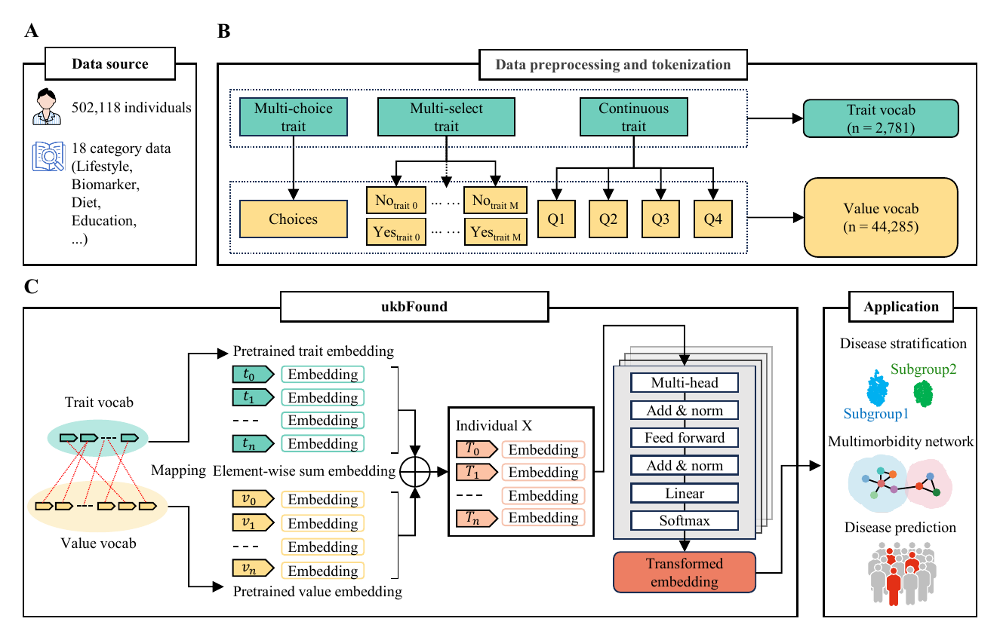

# ukbFound: A Foundation Model for Deep Phenotyping

A lightweight yet rigorous foundation model that encodes thousands of UK Biobank (UKB) traits into language-like sequences for three families of applications: (1) disease subgroup stratification with survival differences; (2) inter-disease correlation/community discovery; and (3) lifestyle-based disease risk prediction.

> This code-only repo contains: training code (`pre-train.py`), Python package modules under `ukbfound/`, example scripts, and Jupyter notebooks for tokenisation and downstream tasks.
> Controlled UKB data, derived token matrices, vocabularies, generated results, and model weights/checkpoints are intentionally excluded from Git. Keep approved local assets under ignored directories such as `data/`, `model/`, or `save/` only when your UKB approval permits.

This is the official codebase for **A foundational model encodes deep phenotyping data and enables diverse downstream application**.

ukbFound is a 25.3M-parameter foundation model that encodes thousands of individual-level traits into language-like sequences. By combining domain-specific tokenisation, position-free embedding, and interpretable reasoning, ukbFound effectively captures latent disease–trait relationships from deep phenotyping data of 502,118 UK Biobank participants.

[](docs/figures/Figure1.pdf)

---

## Highlights

- **Hierarchical tokenisation** for mixed data types
  - *Continuous* → quartiles (Q1–Q4) or similar discretisation.
  - *Multi-choice* → trait token + choice-specific value tokens.
  - *Multi-select* → each choice becomes a binary trait (yes/no).

- **Position-free input embedding**
  Each item is represented by the sum of its *trait* and *value* embeddings, making the model invariant to column order.

- **Pretraining objective**
  Masked language modelling (MLM) with stratified masking across token types, optionally combined with additional objectives (e.g., ECS).

- **Interpretable downstream tasks**
  - Survival analysis for discovered disease subgroups.
  - Cosine-similarity graphs + Leiden clustering for multimorbidity and communities.
  - SHAP-based feature attribution for prediction models.

---

## Repository structure

Reflecting the current repo layout:

```text
ukbFound/
├── pre-train.py                  # main pretraining script (requires UKB-like data)
├── pyproject.toml                # package metadata (install with `pip install -e .`)
├── LICENSE
├── README.md

├── ukbfound/                     # library package
│   ├── __init__.py
│   ├── model.py                  # TransformerModel implementation
│   ├── tokenizer/                # tokenisation utilities (e.g., ValueVocab, trait_tokenizer)
│   ├── preprocess.py             # preprocessing / binning / normalization
│   ├── loss.py                   # MLM and related losses
│   ├── trainer.py                # training loop implementation
│   ├── dsbn.py, grad_reverse.py  # domain-specific batchnorm, gradient reversal
│   └── utils/                    # seeds, logging, metrics, helpers

├── data/                         # ignored local directory for approved data only
│   └── ...                       # do not commit UKB-derived data or token matrices

├── model/                        # ignored local directory for approved model artifacts only
│   └── ...                       # do not commit weights, checkpoints, or vocabularies derived from UKB

├── examples/
│   ├── 01_quickstart.ipynb       # high-level walk-through of the pipeline
│   ├── 02_tokenisation.ipynb     # how traits/values are tokenised
│   └── run_demo.py               # minimal disease-risk prediction demo

└── tutorials/
    ├── UKB-tokenization.ipynb    # full tokenisation pipeline for UKB-style data
    ├── App1.stratification.ipynb # disease subgrouping + KM & Cox models
    ├── App2.correlation.ipynb    # disease–disease correlation & communities
    └── APP3.prediction.ipynb     # lifestyle-only disease prediction + SHAP
````

> **Note:** `data/`, `model/`, model checkpoints, generated CSVs, and audit executables are ignored by default for compliance.

---

## Installation

Tested with **Python ≥ 3.8** and **PyTorch ≥ 1.13** (PyTorch 2.x recommended).

```bash
# 1. Create and activate environment
micromamba create -n ukbfound -c conda-forge \
  python=3.10 \
  numpy pandas matplotlib scikit-learn scanpy jupyterlab \
  seaborn networkx \
  pip

micromamba activate ukbfound

# 2. Install PyTorch (choose the correct CUDA build for your system)
# See https://pytorch.org for the latest command.
pip install --upgrade pip
pip install torch torchvision torchaudio \
  --index-url https://download.pytorch.org/whl/cu121

# 3. Additional dependencies (pip is usually more reliable for these)
pip install igraph shap lifelines

# 4. Install ukbFound in editable mode
cd /path/to/ukbFound
pip install -e .
```

**Optional acceleration.** Flash‑attention can be installed for speed‑ups on compatible GPUs/CUDA. It’s optional; if unavailable, the code falls back to standard attention.

---

## Quick start

### 1) Minimal end-to-end demo: disease risk prediction

This public Git repository is code-only and does not ship datasets, token matrices, vocabularies, or model weights. To run the demo script, first place approved local demo assets or institutionally permitted UKB-derived artifacts under the ignored `data/` and `model/` directories.

Run the new demo script from the repo root:

```bash
python examples/run_demo.py
```

When the expected local assets are present, this script:

1. Loads the local tokenised dataset `data/demo_UKB_tokens.csv` and trait–value dictionary `data/ukb_traits.csv`.
2. Loads local model artifacts from `model/` (`demo_model.pt`, `demo_vocab.json`, `demo_config.json`).
3. Selects a single disease by its `meaning` (default: `"diabetes"`).
4. Constructs binary labels via YES/NO tokens for that disease.
5. Masks the disease-specific tokens in the input (“predict disease from all other traits”).
6. Runs the ukbFound-style `TransformerModel` and uses the probability of the YES token as an individual-level risk score.
7. Computes ROC-AUC using `sklearn.metrics.roc_auc_score`.
8. Splits individuals into risk quartiles (Q1–Q4) based on predicted probabilities, and prints prevalence in each quartile.
9. Plots and saves a ROC curve figure (`data/demo_ROC_diabetes.svg`).

> **Important:** Do not commit UKB-derived data, token matrices, vocabularies, model weights, checkpoints, or generated participant-level outputs to this repository.

### 2) Quickstart notebooks

The following notebooks provide a high-level overview:

* `examples/01_quickstart.ipynb` — a five-minute tour of the pipeline.
* `examples/02_tokenisation.ipynb` — focuses on the tokenisation logic (continuous / multi-choice / multi-select).

### 3) Full pipeline with UKB-style data

For real applications (with approved UKB access), you can follow:

1. `tutorials/UKB-tokenization.ipynb` to build trait and value vocabularies and export tokenised matrices.
2. `pre-train.py` to pretrain ukbFound on UKB-like deep phenotyping data.
3. `App1/2/3` notebooks for downstream analyses (stratification, correlation, prediction).

---

## Pretraining ukbFound (requires UKB-style data)

To pretrain the full model, place UKB-derived tabular features and trait mapping under the expected paths (you may adapt these paths in your local setup):

* `data/UKB/output_data.csv` → main feature matrix (rows = individuals; columns = traits).
* `data/UKB/ukb_traits.csv`   → trait/value vocabularies.

`pre-train.py` exposes all main hyperparameters via a `hyperparameter_defaults` dict at the top of the script. You can configure epochs, batch size, ECS threshold, etc. there.

**Single machine, multi-GPU (recommended):**

```bash
# Example for 4 GPUs
torchrun --standalone --nproc_per_node=4 pre-train.py
```

**Typical settings in `hyperparameter_defaults`:**

```python
epochs         = 50
batch_size     = 40
lr             = 1e-4
layer_size     = 256
nlayers        = 4
nhead          = 4
dropout        = 0.2
mask_ratio     = 0.15
n_bins         = 2
fast_transformer = True
amp            = True
pre_norm       = False
include_zero_trait = True
ecs_thres      = 0.0
DSBN           = False
```

During training, artifacts (args, vocab, checkpoints, logs) are written under a directory such as:

```text
./save/dev_UKB-<timestamp>/
```

---

## Downstream notebooks (reproducing key analyses)

The `tutorials/` folder contains notebooks that mirror the main analyses from the manuscript:

1. **`UKB-tokenization.ipynb`**

   * Build trait and value vocabularies;
   * Construct tokenised matrices;
   * Export `output_data.csv` and related files.

2. **`App1.stratification.ipynb`**

   * Compute disease embeddings;
   * Perform Leiden clustering;
   * Obtain Kaplan–Meier curves;
   * Fit age-adjusted Cox models for subgroup survival differences.

3. **`App2.correlation.ipynb`**

   * Calculate cosine similarity between disease embeddings;
   * Identify multimorbidity pairs;
   * Detect system-level disease communities (e.g., respiratory, cardiovascular).

4. **`APP3.prediction.ipynb`**

   * Train lifestyle-only disease risk models;
   * Evaluate AUC and calibration metrics;
   * Use SHAP to identify risk and protective lifestyle factors.

> For batch runs, you can execute notebooks programmatically using tools such as `papermill`, or convert them to `.py` scripts.

---

## Conceptual design

* **Token vocabularies**

  * *Trait vocabulary* — one token per trait (e.g., height, BMI, smoking frequency, ICD-10 disease, etc.).
  * *Value vocabulary* — quartiles for continuous traits; categorical choices for multi-choice traits; yes/no for multi-select traits.

* **Input representation**
  Each item is represented as:
  [
  \text{emb_item} = \text{emb_trait} + \text{emb_value}
  ]
  Pad/mask tokens are supported. Disease tokens can be over-sampled in the masking schedule if desired.

* **Encoder architecture**
  A configurable Transformer encoder (~25M parameters in the reference configuration) with CLS or mean-pooling for individual embeddings.

* **Training objectives**

  * MLM is the default objective.
  * Optional extensions include elastic cell similarity (ECS), domain adaptation by backprop (DAB), etc.
  * Mixed-precision (AMP) is enabled by default where supported.

* **Distributed training**
  Uses PyTorch DDP with `find_unused_parameters=True`. `LOCAL_RANK` is handled automatically when launched via `torchrun`.

---

## Reproducibility

* Deterministic seeding via a dedicated `set_seed` utility.
* Train/validation splits via `sklearn.model_selection.train_test_split(test_size=0.1, shuffle=True)`.
* W&B logging (offline mode by default) plus text logs (`run.log`) saved alongside checkpoints.
* The demo script (`examples/run_demo.py`) and notebooks expect local approved assets under ignored data/model directories.

---

## Evaluation & expected results (reference)

Using appropriately preprocessed UKB-style data, the notebooks can reproduce the main findings:

* **Subgroup stratification**

  * Prognostically distinct subgroups in multiple diseases;
  * Log-rank tests and age-adjusted Cox models.

* **Disease correlation and communities**

  * Large collections of multimorbidity pairs;
  * System-level disease communities (e.g., respiratory, cardiovascular) from cosine similarity + Leiden clustering.

* **Lifestyle-based prediction**

  * Robust AUCs across a large panel of diseases;
  * Calibration metrics (e.g., Brier scores, calibration curves);
  * SHAP-based interpretation of lifestyle risk and protective factors;
  * Longitudinal risk stratification based on baseline scores.

Exact numbers will vary by cohort definitions, filters, and random seeds. Please refer to the notebooks for disease-specific figures and tables.

---

## Configuration reference

Key configuration flags (in `hyperparameter_defaults` and related configs):

* **Data**

  * `dataset_name`, `n_bins`, `include_zero_trait`.

* **Optimisation**

  * `lr`, `batch_size`, `epochs`, `schedule_ratio`.

* **Architecture**

  * `layer_size` (shared by embedding dimension and feed-forward hidden size),
  * `nlayers`, `nhead`, `dropout`, `pre_norm`.

* **Training tricks**

  * `mask_ratio`, `fast_transformer`, `amp`, `ecs_thres`, `DSBN`, `freeze`.

To resume from a checkpoint, set `load_model` to a previous run directory. It is expected to contain `args.json`, `best_model.pt` and `vocab.json`.

---

## Data availability & ethics

* Individual-level UK Biobank data require an approved project and must comply with UKB’s data access policy.
* This repository is intended to contain code and documentation only.
* Raw UKB data, UKB-derived token matrices, vocabularies, participant-level outputs, model weights, and checkpoints must not be committed.
* Keep approved local assets under ignored directories such as `data/`, `model/`, and `save/`.
* Before pushing, verify the GitHub repository with the UKB Git audit tool required by your compliance workflow.

---

## Citation

If you use ukbFound in your work, please cite the manuscript and this repository (details to be updated once public):

```bibtex
@software{ukbfound_2025,
  title        = {ukbFound: A Foundation Model for Deep Phenotyping},
  author       = {Qiyang Hong and collaborators},
  year         = {2025},
  url          = {https://github.com/qiyanghong2020/ukbFound}
}
```

---

## Acknowledgements

This work was supported by national and institutional funding. We thank all collaborators, clinical partners, and computing support teams. Please see the manuscript for full acknowledgements.

---

## License

This project is licensed under the MIT License – see the [LICENSE](LICENSE) file for details.

---

## FAQ

**Q: My GPU does not support flash-attention. Can I still run ukbFound?**
Yes. Flash-attention is optional. If it is not installed, the code falls back to standard PyTorch attention. You can also explicitly set `fast_transformer=False`.

**Q: How do I run on a single GPU or CPU only?**
Use:

```bash
python pre-train.py
```

and reduce `batch_size` accordingly. Training will be slower, but the demo (`run_demo.py`) and notebooks should still run.

**Q: How do I change which traits are included?**
Modify the tokenisation notebook (`UKB-tokenization.ipynb` or `02_tokenisation.ipynb`) to filter columns before building the vocabularies. Regenerate `output_data.csv` (or analogous files) and retrain or re-run the downstream analyses.
